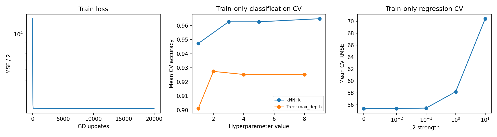

# Измеренные результаты

Команда: `python -m examples.compare_models`.

Классификация: breast_cancer, 80/20 stratified split, seed=42. k и глубина выбраны на 5-fold CV обучающей части.

Выбраны k=9, max_depth=2, min_samples_leaf=5.

| Модель | Test accuracy | Test F1 macro |
|---|---:|---:|
| NumPy kNN | 0.9737 | 0.9713 |
| sklearn kNN | 0.9737 | 0.9713 |
| NumPy tree | 0.8947 | 0.8907 |
| sklearn tree | 0.8947 | 0.8907 |

Совпадение test-предсказаний: kNN — 100.0%, дерево — 100.0%.
Разные правила разрешения равных разбиений и float32 в sklearn могут давать разные деревья.

Регрессия: diabetes, 80/20 split, seed=42. Оба варианта без регуляризации; StandardScaler обучен только на train.

| Модель | Test RMSE | Test R² |
|---|---:|---:|
| NumPy GD | 53.8534 | 0.4526 |
| sklearn OLS | 53.8534 | 0.4526 |

## Что показывает эксперимент

kNN должен совпадать с библиотекой при одинаковых соседях; масштабирование существенно для евклидова расстояния. Дерево ищет осевые пороги по Gini и умеет ограничивать глубину и размер листа. GD приближает решение МНК постепенно, поэтому результат зависит от числа итераций и learning rate.

Отдельная кривая L2 получена на CV внутри train. При большой регуляризации коэффициенты сжимаются, но качество может ухудшиться из-за недообучения. Для сравнения GD с МНК заранее использован l2=0.

Один split не характеризует все данные; train CV std не является доверительным интервалом. Время в JSON — одиночное измерение на текущем CPU, не строгий бенчмарк.

Точные значения, версии и все CV-точки: [metrics.json](metrics.json).
